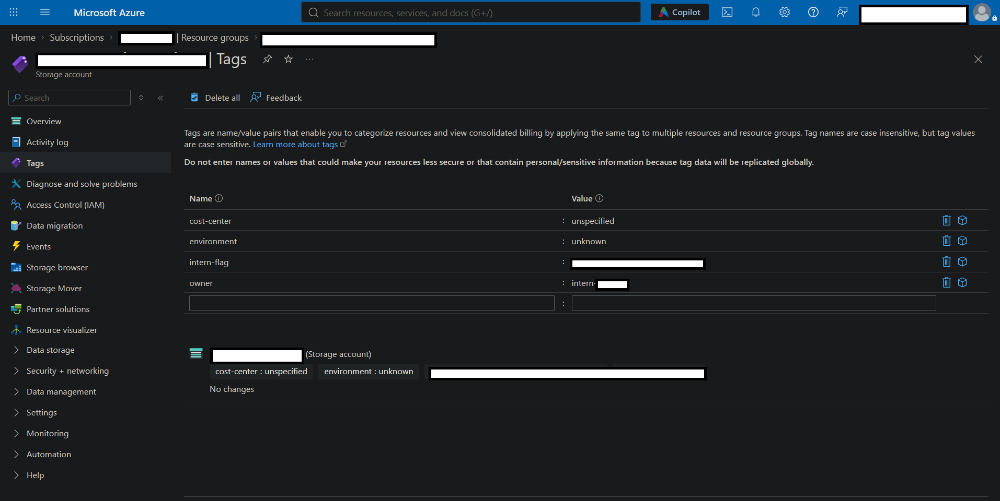
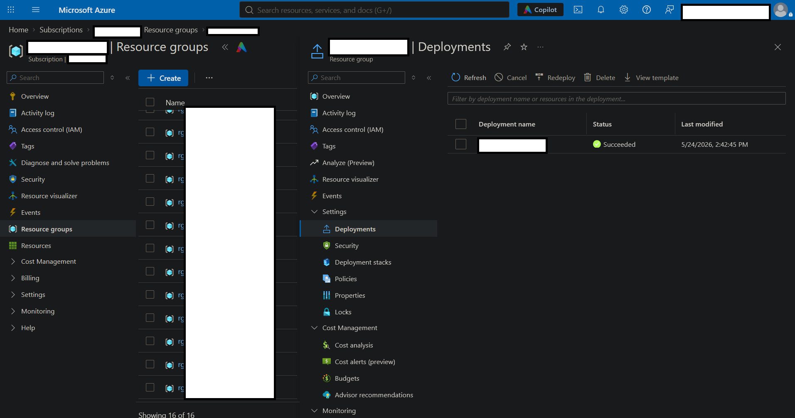
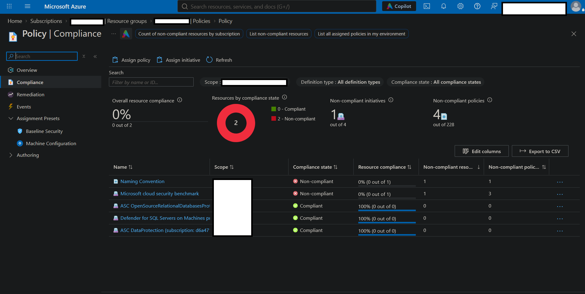
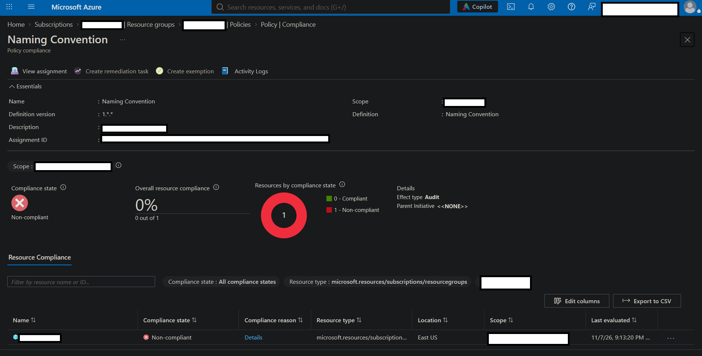

# <strong>Dead Deploy </strong>
# Investigating Azure Policy Misconfiguration and Governance Failures

## Scenario
A junior intern was granted temporary Contributor access within a live, multi-user Azure training tenant to deploy a test environment. Following the discovery of a non-compliant deployment, an investigation was initiated to assess resource configuration, identify deviations from organisational naming and tagging standards, and determine why Azure Policy enforcement failed to prevent such a deployment.

## Environment
Platform: Microsoft Azure    
Cloud environment: Live multi-user Azure training tenant    
Services: Resource Groups, Azure Resource Manager (ARM) Deployments, Azure Policy
Tools: Azure Portal    
Access level: Reader (read-only)    
Scope: Assigned training subscription and associated resource groups

## Documentation & Redaction  
Screenshots included in this report have been selectively censored to remove sensitive environment identifiers and preserve the confidentiality of the training tenant. Lab flags and challenge-specific identifiers have also been redacted to maintain the integrity of the exercise and avoid disclosing solutions.

## Investigation Procedure
### Step One: Finding the Non-Compliant Deployment
The first step was to discover the offending deployment. Upon navigating through the Azure portal into the Resource Manager and then accessing the list of Resource Groups, one such RG became immediately suspect, as it was only the one that did not follow the organisation's established naming convention, which in this case happens to follow Microsoft's recommended naming conventions. [Microsoft Naming Conventions](https://learn.microsoft.com/en-us/azure/cloud-adoption-framework/ready/azure-best-practices/resource-naming). This deviation made this RG a suitable starting point for further investigation. This was the first flag of the lab, and thus it shall not be shown to preserve the integrity of the exercise. 

### Step Two: Establishing a Suspect

The next step was to investigate the misnamed resource group. In it was one resource. Upon expanding its Tags blade, the 'intern-flag' was discovered.

The intern was previously instructed to use this identifying tag whenever they documented resources. This certainly establishes the intern as a prime suspect.

### Step Three: Following the Trail

The next stage involved examining the resource group's Deployments blade to establish how and when the resource was provisioned. Azure Resource Manager (ARM) maintains deployment records containing information such as deployment names and timestamps, which can also provide additional context linking the deployment to the earlier findings. The deployment history revealed an unusually named deployment, the timing of which corresponded with the intern's experiment.  

 

By correlating the deployment record with the identifying resource tag, the investigation established a consistent timeline of activity associated with the intern's test environment.

### Step Four: Establishing the Why

It is now necessary to understand why this deployment was allowed to go through at all. This particular policy was intended to enforce naming conventions. Upon analysis of the policies blade, it is confirmed that this resource is non-compliant. 

Upon inspecting its parameters, it is revealed that the non-compliant effect is set to 'Audit'. And therein lies the rub. 

Azure Policy's Audit effect identifies and records non-compliant resources without blocking their creation, which is why this deployment went through.

## Summary of Findings
1. Naming convention violations: An improperly named resource group was provisioned outside the established organisational naming standard. The deployment itself was also misnamed.
2. Governance enforcement failure: The assigned naming convention policy was configured with the 'Audit' effect, allowing non-compliant resources to be created.
3. Insufficient deployment oversight: The deployment was performed using temporary Contributor access, while the existing governance controls were insufficient to prevent non-compliant provisioning.

## Recommendations
It is clear that in this situation, monitoring this violation is not sufficient. Thus, it is advisable to change the policy effect to Deny to simply prevent non-compliant deployments that violate the naming standard from going through.  Furthermore, temporary Contributor access should be reviewed and restricted according to the principle of least privilege. Access should also be revoked once the intended task has been completed.  

## What I learned
- I learned that Azure Policy effects determine whether non-compliant resources are merely identified or actively prevented from being deployed. The distinction between Audit and Deny is particularly important when implementing preventative governance controls.
- I gained practical experience examining Azure Resource Groups, resource tags, and ARM deployment history to investigate unexpected resource provisioning. 
- In a future investigation, I would correlate deployment history with Activity Logs earlier in the process to establish a more reliable timeline of events and to identify the identity responsible for each operation.

## What surprised me
It is fascinating that a policy can exist, be assigned, and report compliance violations while still allowing the exact behaviour it was intended to discourage. The importance of correctly assigning Azure Policies and resource locks (i.e. governance) must therefore be an extremely meticulous and painstaking endeavour. 
