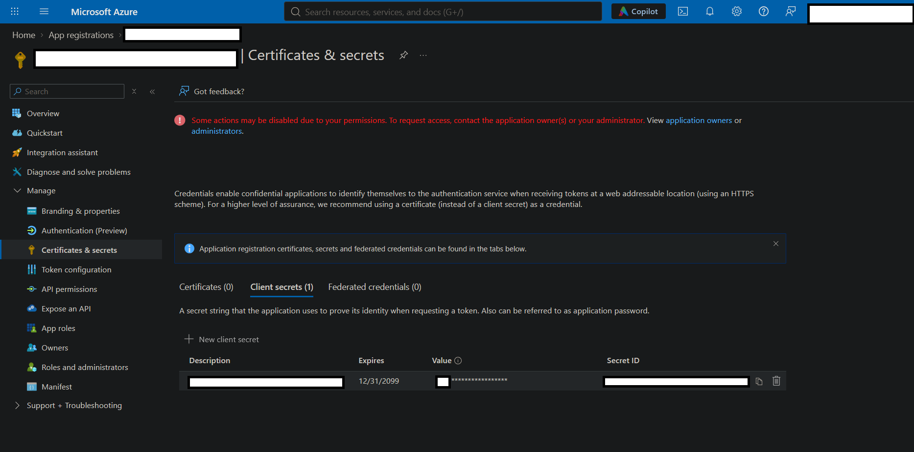

# The Stolen Identity
## Forensic reconstruction of a five-stage OAuth consent-phishing kill chain across two linked app registrations
_________________

## Scenario
An adversary was able to infiltrate the organisation's tenant. During the intrusion, no security alerts were raised, nor did monitoring systems in place identify any suspicious activity. The initial compromise reveals only that a company employee was phished and their session token stolen through a fake login page. The employee also fulfilled MFA, meaning that the attacker was able to use the stolen MFA-satisfied token to bypass Conditional Access policies in place. This investigation will first attempt to identify the point of entry, then retrace each stage of the attack path using uncovered evidence. The objective is thus: to uncover where the adversary got in, what they did, and what they took.  

## Environment
Platform: Microsoft Azure    
Cloud environment: Live multi-user Azure training tenant    
Services: 
Tools: Azure Portal    
Access level: Reader (read-only)    
Scope: Assigned training subscription and associated resource groups

## Documentation & Redaction  
Screenshots included in this report have been selectively censored to remove sensitive environment identifiers and preserve the confidentiality of the training tenant. Lab flags and challenge-specific identifiers have also been redacted to maintain the integrity of the exercise and avoid disclosing solutions.

## Investigation Procedure
### Step One: Entry
The employee interacted with a fake login page. The employee, believing the integrity of the login portal, also fulfilled MFA. The attacker stole the MFA-satisfied session token, and used it to bypass the active Conditional Access policies. In other words, the attacker has taken control of an employee account. Under the guise of a legitimate employee, it is much harder to detect suspicious activity, perhaps somewhat explaining the failure of monitoring systems in place. Disastrously, the principle of least privilege had been neglected, leaving an employee account as the owner of a legacy application for which it had no apparent need. The power of an owner account should never be taken for granted.   

### Step Two: Escalation
By itself a standard account would not have much power in this scenario. The problem is that the legacy application's service principal does. Through poor access control management, this standard employee account inadvertently has owner account power over this legacy application. If the attacker can assume control of the service principal, they will obtain the permissions of the service principal, which is (in this instance) far more powerful than the permissions of a standard account. 

To this end, the attacker modified the Certificates and Secrets of this application leveraging their owner privileges. This enabled them to add a new Client Secret to the application. 

 

It is immediately suspicious that this Client Secret has such a long expiration date. This presents the attacker with the opportunity to persist on the tenant.

### Step Three: Pivoting

### Step Four: Persistence

### Step Five: Looting

## Summary of Findings

## Recommendations

## Key Takeaways

## Unexpected Findings
