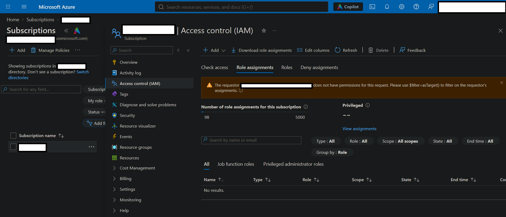
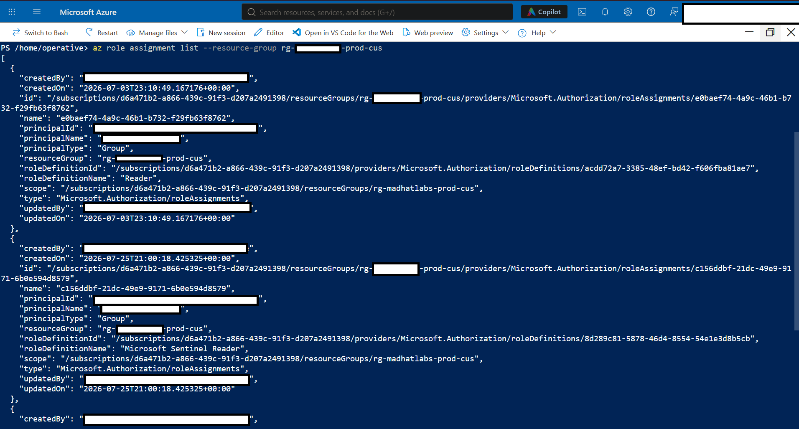
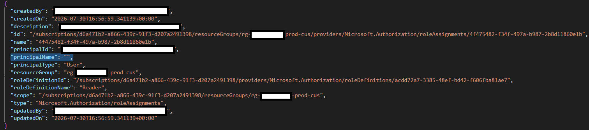
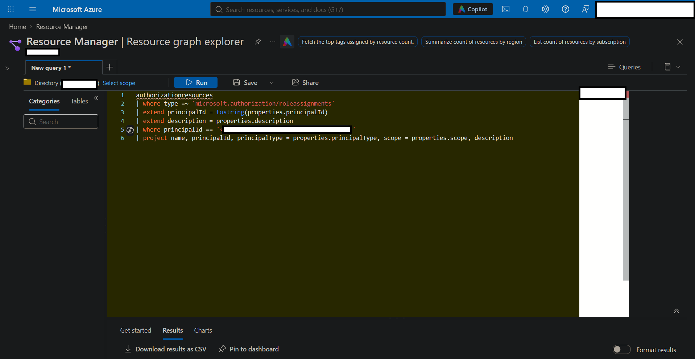
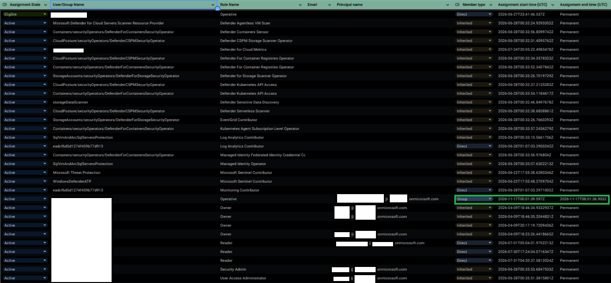
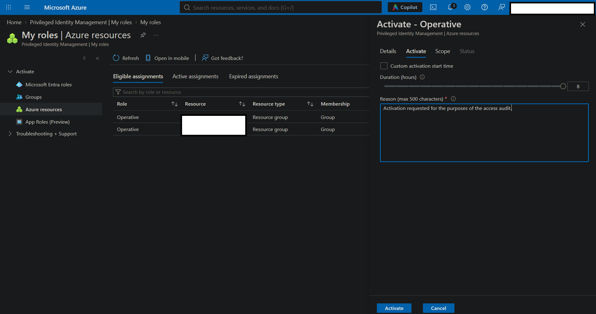
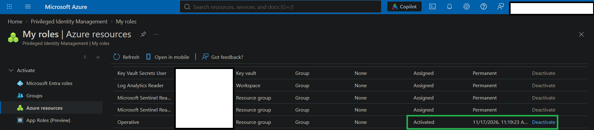
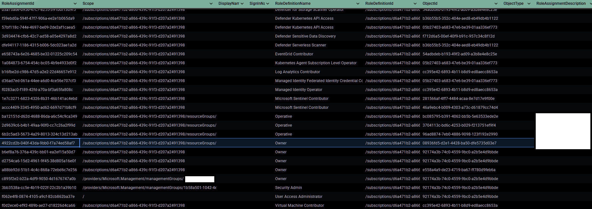

# Privilege Audit
## Examining Azure Resource Access, Privilege Assignments, and RBAC Audit Methodologies
_________________

## Scenario

The organisation, now wary following a recent security breach, has requested an audit of its Azure tenant to identify any violations of least-privilege that require remediation.

## Environment
Platform: Microsoft Azure  
Cloud environment: Live multi-user Azure training tenant  
Services: Azure Resource Manager (RBAC), Microsoft Entra ID, Privileged Identity Management (PIM), Azure Resource Graph  
Tools: Azure Portal, Azure CLI, Resource Graph Explorer (KQL), PIM  
Access level: Reader (read-only), with one PIM-eligible Azure role  
Scope: Assigned training tenant, including Azure resource role assignments across management groups, subscriptions, resource groups, and individual resources.  

## Documentation & Redaction  
Screenshots included in this report have been selectively censored to remove sensitive environment identifiers and preserve the confidentiality of the training tenant. Lab flags and challenge-specific identifiers have also been redacted to maintain the integrity of the exercise and avoid disclosing solutions.

## Audit Methodology

### Step 1: Access Control (IAM)

The first logical step in this access audit is to establish a baseline of the permissions assigned across the Azure environment. To this end, the Access Control (IAM) blade provides an overview of role assignments at each resource scope (i.e. direct or inherited) at a glance. Note that in this scenario, the audit account does not have sufficient permissions to view the role assignments directly through the IAM blade.

 
 **Figure 1: The Azure Access Control (IAM) blade at subscription scope.** 

More useful still is the full CSV export of role assignments, which was provided by the organisation, as the audit account does not have sufficient permissions to retrieve the full export directly from the system. Upon review of this document, it is revealed that one user has the Owner role at the subscription and has separate Owner assignments across numerous resource groups within that same subscription. To quantify: the account has 64 Owner assignments across one subscription, consisting of 1 subscription assignment and 63 resource group assignments. 

 
 **Figure 2: The full CSV export of role assignments, sorted by sign-in name.** 

The first question is whether or not the account needs Owner privileges in the first place. Additionally, as the subscription level assignment already grants Owner access to its child resource groups, the individual resource group level assignments are redundant. And further still, removing the broad assignment on the subscription would not fully revoke privileges across each resource group. Each separate assignment would need to be identified and removed as well. 

### Step 2: Azure CLI

While that CSV is very useful at a glance, there are notable blind spots in the export that should be considered carefully. Within it, group assignments do not reveal the individual members receiving access. It may also omit orphaned identities (i.e. identities that have been deleted or can no longer be resolved), which require further investigation. The Azure Command Line Interface (CLI) allows an auditor to enumerate the same assignments, but also provides access to fields that are not as readily visible in the portal, such as principal IDs and unresolved principal names. A missing principal name does not necessarily mean the account has been deleted, but it does indicate that the identity could not be resolved, and thus warrants investigation. Note that the audit account does not have sufficient permissions to complete the principal lookup, so no names are returned.

 
 **Figure 3: An Azure CLI command to enumerate role assignments. An alternative PowerShell cmdlet is 'Get-AzRoleAssignment'.** 

The organisation provides a JSON output of this command, run at the appropriate scope. Subsequent analysis reveals one assignment where the principalName is blank (null), indicating that the principal could not be resolved. The organisation confirms that the account was deleted, but the associated permission remains assigned.

 
 **Figure 4: An orphaned account.** 

Deleting an identity does not automatically remove its Azure RBAC role assignments. If the original identity were restored, it could potentially regain access through these leftover permissions. It is therefore imperative to identify and remove such orphaned assignments.

### Step 3: Resource Graph (KQL)

Whereas the IAM blade and Azure CLI each work one scope at a time, Resource Graph allows an auditor to query role assignments across multiple subscriptions within the tenant in a single Kusto Query Language (KQL) query. This makes it possible to examine many subscriptions simultaneously, dramatically increasing efficiency.

 
 **Figure 5: A targeted KQL query using the previously identified orphaned principal ID.** 

The results available to the audit account remain restricted by its permissions, as evident in the broader CSV export, which does not include the orphaned assignment identified through the earlier CLI investigation. Although the audit account cannot retrieve the full set of assignments in this scenario, Resource Graph remains a particularly useful tool for conducting tenant-wide access reviews when sufficient permissions are available.

### Step 4: Privileged Identity Management (PIM)

The methods thus far have assessed active role assignments, but have not considered eligible role assignments. This distinction can be explored using Privileged Identity Management (PIM). An active assignment grants the principal permission to use the role immediately, whereas an eligible assignment allows the principal to activate that role when required, subject to any configured activation requirements. This distinction is important because an audit of active assignments alone would overlook privileges that can be activated at a later time. Eligible assignments still represent authorised access to potentially sensitive resources, and should therefore be reviewed to establish whether the principal requires that level of access in the first place. 

 
 **Figure 6: A PIM Assignments (Preview) export of an accessible resource group within the subscription. Highlighted is an eligible role assignment, which grants the principal the ability to activate the role for up to eight hours, after which the active assignment expires.** 

Reviewing both role assignment types allows an auditor to identify privileges that may otherwise go unnoticed and assess whether they are appropriately assigned. PIM provides this additional layer of visibility. 

### Step 5: The Hunt

This audit will now apply the aforementioned methods together to examine a previously hidden resource group. The audit account first requests activation of its eligible role assignment through a designated group. Activating this role will expand the scope of resources accessible to the audit account.

 
 **Figure 7: The audit account requests activation through PIM.** 

The organisation had established the eligible group assignment for the audit account, allowing the activation request to proceed successfully, as shown below.

 
 **Figure 8: The successful activation of a time-bound role assignment through PIM.** 

The audit account now has access to the previously hidden resource group. The first step is to examine the IAM blade.The output CSV reveals some very interesting findings. 

 
 **Figure 9: The Azure Access Control (IAM) blade at hidden resource group scope.** 

The IAM export revealed four Owner assignments, two of which are assigned to the same principal at subscription scope. That same principal also holds an Owner assignment on a management group. Further investigation of its other role assignments revealed additional privileges, including Security Administrator at another management group and User Access Administrator at the tenant root scope (/). This highlights a principal with extensive privileges across the Azure hierarchy, warranting further investigation into whether these assignments are actually necessary.

## Findings and Investigation
## Summary of Findings
## Methodology Comparison
## Recommendations
## Key Takeaways
## Unexpected Findings
