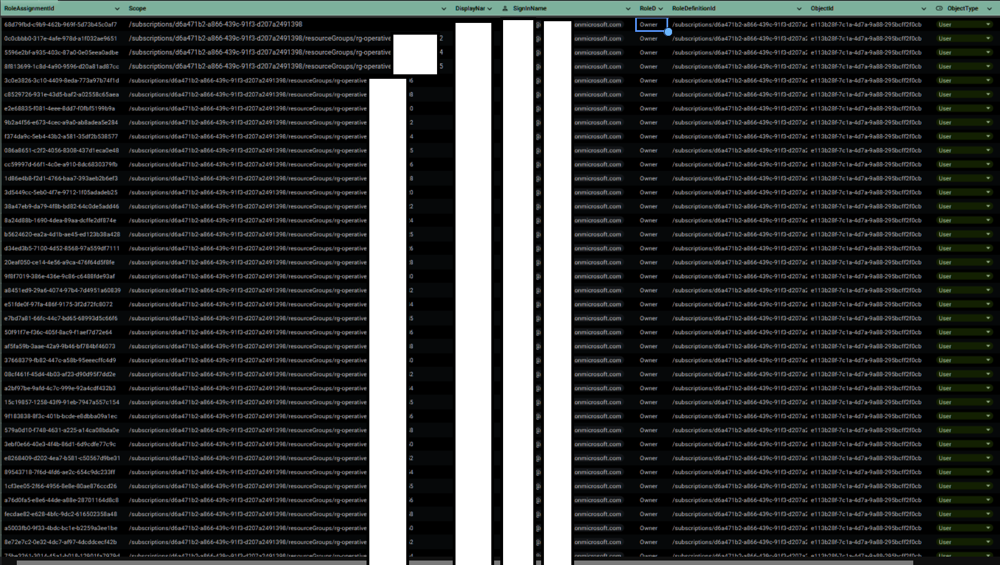

# Privilege Audit
## Examining Azure Resource Access, Privilege Assignments, and RBAC Audit Methodologies
_________________

## Scenario

The organisation, now wary following a recent security breach, has requested an audit of its Azure tenant to identify any violations of least-privilege that require remediation.

## Environment
Platform: Microsoft Azure  
Cloud environment: Live multi-user Azure training tenant  
Services: Azure Resource Manager (RBAC), Microsoft Entra ID, Privileged Identity Management (PIM), Azure Resource Graph  
Tools: Azure Portal, Azure CLI, Resource Graph Explorer (KQL), PIM  
Access level: Reader (read-only), with one PIM-eligible Azure role  
Scope: Assigned training tenant, including Azure resource role assignments across management groups, subscriptions, resource groups, and individual resources.  

## Documentation & Redaction  
Screenshots included in this report have been selectively censored to remove sensitive environment identifiers and preserve the confidentiality of the training tenant. Lab flags and challenge-specific identifiers have also been redacted to maintain the integrity of the exercise and avoid disclosing solutions.

## Audit Methodology

### Step 1: Access Control (IAM)

The first logical step in this access audit is to establish a baseline of the permissions assigned across the Azure environment. To this end, the Access Control (IAM) blade provides an overview of role assignments at each resource scope (i.e. direct or inherited) at a glance. Note that in this scenario, the audit account does not have sufficient permissions to view the role assignments directly through the IAM blade.

 
 **Figure 1: Azure Access Control (IAM) blade at subscription scope.** 

More useful still is the full CSV export of role assignments, which was provided by the organisation, as the audit account does not have sufficient permissions to retrieve the full export directly from the system. Upon review of this document, it is revealed that one user has the Owner role at the subscription and has separate Owner assignments across numerous resource groups within that same subscription. To quantify: the account has 64 Owner assignments across one subscription, consisting of 1 subscription assignment and 63 resource group assignments. 

 
 **Figure 2: Full CSV export of role assignments, sorted by sign-in name.** 

The first question is whether or not the account needs Owner privileges in the first place. Additionally, as the subscription level assignment already grants Owner access to its child resource groups, the individual resource group level assignments are redundant. And further still, removing the broad assignment on the subscription would not fully revoke privileges across each resource group. Each separate assignment would need to be identified and removed as well. 

### Step 2: Azure CLI

### Step 3: Resource Graph (KQL)

### Step 4: Privileged Identity Management (PIM)

### Step 5: The Hunt

## Findings and Investigation
## Summary of Findings
## Methodology Comparison
## Recommendations
## Key Takeaways
## Unexpected Findings
